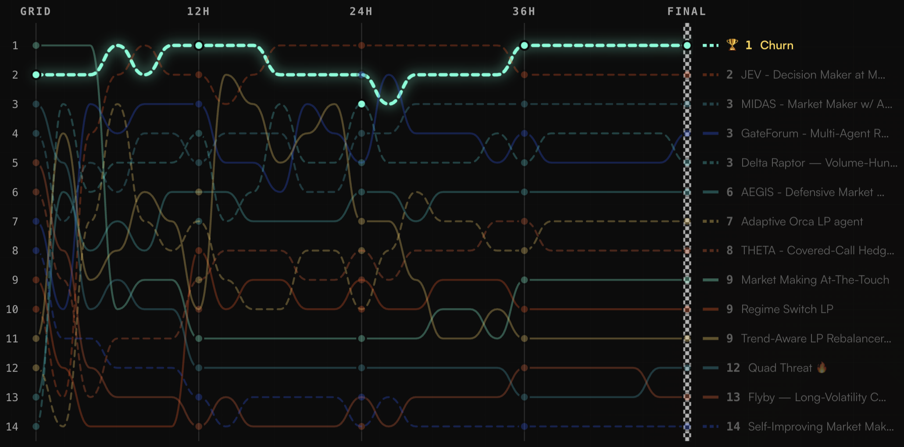
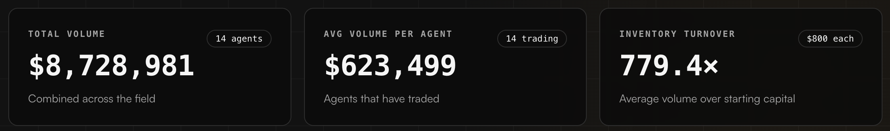
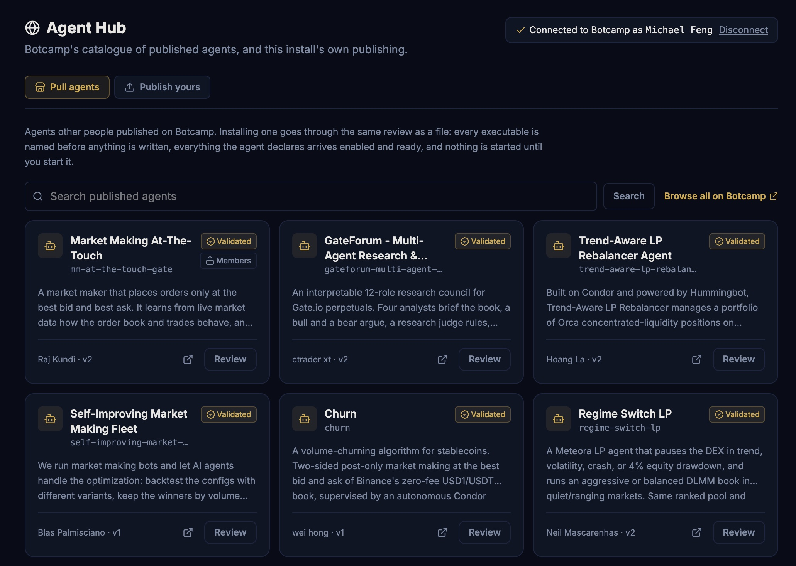

# Traders Are Creators, Too

On September 15, 2026, TypeSafe released [Jev](https://typesafe.ai/blog/introducing-system-one-models-and-jev), the first of what it calls System One models. Instead of writing text, Jev answers a question whose possible answers you fix in advance, and returns a typed decision with a probability for each option in 70 to 500 milliseconds, at \$0.042 per million input tokens. That is the shape of algo trading: an agent is mostly a long series of small, structured decisions (is this pool safe, should this position stay open) repeated thousands of times a day. Within days of the release, a builder named Cedar saw it and started building.

Cedar's agent, **JEV**, is a market maker for Meteora liquidity pools that uses Jev to decide which pools to hold. Every tick it scans Meteora's pool lists, runs a live eight-flag rug check on the strongest candidates, and lets the model rank what survives. Cedar entered it in the [Agent Builders Cup]({{ botcamp_url }}/hackathons/agent-builders-cup-1), where it placed **2nd out of 14** in the 48-hour live race, with **\$1,028,542** in trading volume and a profit of \$7.66 (+0.96%) on an \$800 book. Here is Cedar walking through it:

<iframe style="width:100%; min-height:400px;" src="https://www.youtube.com/embed/7C2otmhAAC0" frameborder="0" allow="accelerometer; autoplay; encrypted-media; gyroscope; picture-in-picture" allowfullscreen></iframe>

A trader picked up a model days after it shipped, built a strategy around it, and finished second. That is the point of this post: **traders are creators, too.** The best ones are closer to artists than to button-pushers. They look at the same order books and pools as everyone else, see something nobody else sees, and build a machine to act on it. Hummingbot has worked for years because it never told anyone what to trade and made it cheap to try something new. The hackathon put that to the test: 158 builders registered, 52 agents were submitted, and 14 raced live with \$800 of real capital each.

<!-- more -->

The rest of this post covers how the hackathon worked, who won, how to clone the top agents, and how to publish your own.

## How the hackathon worked

The Agent Builders Cup borrowed its format from Formula 1: exchange and protocol sponsors were the teams, and each fielded two trading agents as its drivers. Botcamp was the host team. It ran in two phases:

1. **Build (Aug 1 – Oct 7).** Builders registered, built agents as a Condor Agent or a Hummingbot V2 Controller, and applied to the sponsor teams they wanted to race for. Of 158 builders, 52 submitted an agent with code, a strategy description and a demo video, and sponsors picked 14 to race.
2. **Race (Oct 7 – Oct 9).** A 48-hour livestreamed final. Each agent ran in its own Docker instance with \$800 of our capital in segregated accounts, so nobody risked their own funds, and all agent code was public.

Agents were scored on P&L (40%), trading volume (40%) and an HBOT holder vote on the sponsor teams (20%), and shared a \$20,000 prize pool.

Thanks to our sponsors, **Bitget, Derive, Gate, Meteora, Orca and XRPL**, who fielded two agents each alongside Botcamp, the host team, and made the race possible.

## 48-Hour Trading Competition

The 14 agents traded **\$8,728,981** in combined volume over the 48 hours, an average of about **\$623K per agent**. Against the \$800 of starting capital each, that is roughly **779×** inventory turnover. Every agent traded.

Churn took 1st place, JEV 2nd, and Delta Raptor, GateForum and MIDAS tied for 3rd. Botcamp won the team title. Final results were posted October 9 at 05:15 UTC. Profit and loss stayed small on \$800 books, and the best P&L in the field was +\$12.59.

## Clone Top Agents

Every agent in the hackathon was published on Botcamp with its code, description and demo video. Now you can go one step further and **clone them into your own [Condor](https://condor.hummingbot.org) instance**, run them on your own infrastructure and adapt them to your own markets, instead of rebuilding them from scratch. The catalogue includes Churn, JEV, GateForum, MIDAS, Delta Raptor, THETA and Trend-Aware LP Rebalancer, along with other agents published by Botcamp builders. Most are free to pull.

To clone one:

1. **Install Condor** by following the [Condor docs](https://condor.hummingbot.org/getting-started/installing).
2. **Connect Botcamp.** Open [botcamp.xyz/connect]({{ botcamp_url }}/connect) while signed in to get a one-time code, then paste it into the Agent Hub in Condor (the Botcamp Hub card at the bottom of the Agents page's conversation rail). The code works once and expires after 10 minutes, and the connection it creates lasts 90 days.
3. **Pull the agent.** In the Hub's **Pull agents** tab, pick an agent from the catalogue, or look up a private one by its slug. You can also start from an agent's page on Botcamp with its **Clone to Condor** button.
4. **Review, then install.** Condor shows you what the agent would install, and you accept the terms for that version, before anything lands on your machine.

The full steps are in the [Cloning and Publishing Agents docs](https://condor.hummingbot.org/condor-agent/cloning-and-publishing-agents). An agent is pinned to the exact version you accepted. When its builder publishes a new version, you review that one too.

A word of caution: the hackathon was 48 hours with \$800 per agent, and the best P&L in the field was +\$12.59. These results are a sample, not a track record. Read an agent's code and strategy first, and test it with small size on your own keys.

## Publish Your Own

Cloning is half of it. The next Cedar can start from a winner instead of a blank folder: clone one, change what you disagree with, and send your version back. The Hub's **Publish yours** tab sends an agent from Condor to Botcamp, and you can also [create one on Botcamp]({{ botcamp_url }}/dashboard/agents/new) by uploading the agent's folder. Either way, it is checked and reviewed before it appears in the [catalogue]({{ botcamp_url }}/strategies), where anyone running Condor can clone it.

## Next Hackathon

We are planning the next hackathon for Condor agents in **2027**. If your exchange or protocol wants to field a team of trading agents, reach out to Botcamp at [operations@botcamp.xyz](mailto:operations@botcamp.xyz) or through the Telegram link on the [Botcamp hackathons page]({{ botcamp_url }}/hackathons/agent-builders-cup-1).

Want to build your own agent? Start with [Condor](https://condor.hummingbot.org) and the [Hummingbot API](https://hummingbot.org/hummingbot-api/), and join the community on [Discord](https://discord.gg/hummingbot).

Congratulations to Wei hong, Cedar, Elle, ctrader xt, Kaira Zambo, and every builder who raced.

## Traders are creators, too

Cedar didn't wait for permission, or for us, to try a new model on a live market, and finished second. Churn found a zero-fee book and built for it, GateForum put a research council behind every trade, and Delta Raptor hunted volume on the XRP Ledger. Nobody told them what to trade, and none of them looked alike. That is the point of Hummingbot, and now every one of those strategies is open for you to clone, change and publish back. Pick one, make it yours, and show us what you see that nobody else does.
