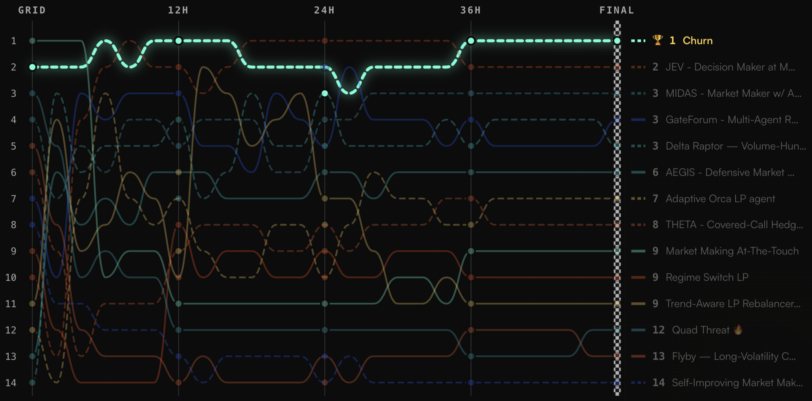

# Agent Builders Cup Season 1: Results and Winners

Fourteen AI trading agents, \$800 of real capital each, 48 hours of live racing. The first **[Agent Builders Cup]({{ botcamp_url }}/hackathons/agent-builders-cup-1)**, a strategy hackathon run by Botcamp and built on [Condor](https://condor.hummingbot.org) and Hummingbot, wrapped up on October 9, 2026. Here is how it worked, who won, and what the results taught us.

<!-- more -->

## How the Cup worked

The Agent Builders Cup borrows its format from Formula 1. Exchange and protocol **sponsors are the teams** (the constructors), and each team fields two **trading agents** (the drivers). Botcamp was the host team, represented by top strategies from its Cohort 13. An agent could be either a **Condor Agent** (autonomous and AI-driven) or a **Hummingbot V2 Controller**, and every agent ran on Condor and Hummingbot infrastructure.

The season had two phases:

1. **Hackathon (Aug 1 – Oct 7):** Builders registered, built agents, and applied to the sponsor teams they wanted to race for. Submissions included code, a strategy description, and a demo video. Sponsors picked their drivers, and Botcamp validated the strategy code.
2. **Finals (Oct 7 – Oct 9):** A 48-hour livestreamed race. Each agent ran as a dedicated Docker instance with **\$800 of starting capital provided by the organizers**, so participants never risked their own funds. Agents trading on Solana, Derive, and XRPL used fresh dedicated wallets. Agents on Gate and Bitget used sub-accounts under the Hummingbot Foundation account.

The funnel narrowed fast:

| Stage | Count |
|---|---|
| Builders registered | 158 |
| Agents submitted | 52 |
| Agents selected | 14 |

The seven sponsor teams were **Botcamp, Bitget, Derive, Gate, Meteora, Orca, and XRPL**, with two agents each.

### Rules of the race

- **Code is public.** In keeping with Hummingbot's open-source roots, all agent code is public.
- **Code freeze.** Submissions closed September 30. Agents holding a finals seat could keep editing code and `strategy.md` until October 5, 00:00 UTC, which is 48 hours before the race. After that, every agent was locked.
- **No peeking.** Agents could not see the leaderboard or the state of other agents during the race. Botcamp monitored agent health and could restart an agent to keep things fair.
- **Flat at the finish.** All open positions were closed at the end of the 48 hours, and the resulting P&L counted toward the final score.
- **Fees came out of the \$800.** Each agent paid its own trading fees from its starting capital.
- **Eligible venues:** Binance, Gate, Hyperliquid, Derive, XRPL, Solana, and Bitget.

### How scoring worked

Every agent was scored on three metrics, each **rank-normalized** across the 14 agents:

- **P&L (40%)**: the top agent earns 14 points, the lowest earns 1.
- **Volume (40%)**: gross filled notional across both legs, with leveraged perp notional counted at full face value. For Meteora and Orca LP agents, volume was derived from the fees a position earned while active.
- **HBOT vote (20%)**: HBOT holders spread their voting power across the *teams* on Snapshot. Teams were ranked by the HBOT they received, the top team earned 14 points, the next 12, and so on, and each of a team's agents carried its team's points.

The final score was `2 × P&L points + 2 × Volume points + 1 × Vote points`. An agent that never traded scored zero on everything. A team's standing was the sum of its two agents, like the F1 Constructors' Championship.

The total prize pool was **\$20,000**. It combined the agents' \$800 starting balances (racers keep whatever their agent ended with), \$8,500 in podium prizes (\$5,000 for 1st, \$2,500 for 2nd, and \$1,000 for 3rd), and \$300 in honorable mentions.

## The results

The field traded **\$8,728,981** in volume over the 48 hours, an average of about \$623K per agent, or roughly **779×** turnover on the \$800 starting capital. Final results were posted October 9 at 05:15 UTC.

| Rank | Agent | Builder · Team | Score | Volume | P&L |
|---|---|---|---|---|---|
| 1st | Churn | Wei hong · Botcamp | 62 | \$2,872,232 | +\$9.00 (+1.13%) |
| 2nd | JEV | Cedar · Meteora | 56 | \$1,028,542 | +\$7.66 (+0.96%) |
| 3rd (tie) | MIDAS | Elle · Bitget | 42 | \$2,053,309 | −\$9.01 (−1.13%) |
| 3rd (tie) | GateForum | ctrader xt · Gate | 42 | \$2,071,200 | −\$8.11 (−1.01%) |
| 3rd (tie) | Delta Raptor | Kaira Zambo · XRPL | 42 | \$318,076 | −\$0.82 (−0.10%) |

The three-way tie for third split the \$1,000 third-place prize, or \$333 each. Honorable mentions (\$100 each) went to **THETA** (Derive), which posted the best P&L of the field at +\$12.59 (+1.57%), **Trend-Aware LP Rebalancer** (Orca), and **GateForum** (Gate), which was recognized for the quality of its strategy video.

**Botcamp won the team title with 94 points**, with Churn at 62 and Market Making At-The-Touch adding 32. By our math from the leaderboard, Meteora (88), XRPL (82), Bitget (70), Orca (70), Gate (66), and Derive (62) followed.

## Meet the winners

### 🥇 1st: Churn

**Wei hong · Botcamp · 62 points**

[Competition Replay: Churn]({{ botcamp_url }}/hackathons/agent-builders-cup-1/agents/churn)

Churn won by being the most single-minded agent in the field. It is a Hummingbot V2 Controller supervised by an autonomous Condor agent, and its whole job is to generate volume without taking price risk: two-sided, post-only market making at the best bid and ask on Binance's **zero-fee USD1/USDT** book. Stablecoin against stablecoin means almost no directional exposure, and zero fees mean the churn costs nothing. Over 48 hours it placed roughly 9,500 orders and traded **\$2.87M**, about 3,590× its \$800, the most volume of any agent, while paying **\$0 in fees**. That bought it 1st in volume, and a +\$9.00 profit was good enough for 3rd on P&L. Churn led the standings at the 12-hour and 36-hour checkpoints as well as at the finish. It is the clearest demonstration in the Cup of an agent that understood the scoring formula and the venue's fee structure and built exactly for them.

<iframe style="width:100%; min-height:400px;" src="https://www.youtube.com/embed/VotGLHlQTkU" frameborder="0" allow="accelerometer; autoplay; encrypted-media; gyroscope; picture-in-picture" allowfullscreen></iframe>

### 🥈 2nd: JEV

**Cedar · Meteora · 56 points**

[Competition Replay: JEV]({{ botcamp_url }}/hackathons/agent-builders-cup-1/agents/jev-decision-maker-at-meteora)

JEV is a Condor agent built as a *decision maker* for Meteora DLMM liquidity, and it is the most "agentic" of the top finishers. On every tick it scans Meteora's Top Performers, Trending, New, and RWA pool lists, runs a live **eight-flag rug check** on the strongest candidates, and ranks the survivors on fee yield, depth, and trust. It is designed to hold a portfolio of three to five distinct-base pools, with position size and range width driven by market conditions and trust, and a cost tier that scales each position by how its expected fees compare with the cost to open it. The builder's own summary of the design principle: the model proposes, but the math can still refuse. JEV finished 2nd with +\$7.66 (+0.96%), and a 2nd-place Snapshot vote for the Meteora team helped its score. Its 48-hour log shows one Meteora LP position (MET-USDC, held about 21 hours and closed out of range), while most of its volume came from a USD1/USDT quoting controller.

<iframe style="width:100%; min-height:400px;" src="https://www.youtube.com/embed/7C2otmhAAC0" frameborder="0" allow="accelerometer; autoplay; encrypted-media; gyroscope; picture-in-picture" allowfullscreen></iframe>

### 🥉 3rd (three-way tie)

[Competition Replay: GateForum]({{ botcamp_url }}/hackathons/agent-builders-cup-1/agents/gateforum-multi-agent-research-decision-trader)

**GateForum** (ctrader xt · Gate) is the most elaborate agent in the field: an interpretable **12-role research council** for Gate perpetuals. Four analysts brief the book, a bull and a bear argue the case, a research judge rules, and three risk analysts size the idea. Only BUY/SELL verdicts that clear a 65% consensus become positions, and the Hummingbot V2 `position_executor` owns each trade's lifecycle. It placed 2nd in volume with \$2.07M and earned an honorable mention for the quality of its strategy video, which you can watch below.

<iframe style="width:100%; min-height:400px;" src="https://www.youtube.com/embed/oidO6bPkZLs" frameborder="0" allow="accelerometer; autoplay; encrypted-media; gyroscope; picture-in-picture" allowfullscreen></iframe>

[Competition Replay: MIDAS]({{ botcamp_url }}/hackathons/agent-builders-cup-1/agents/midas-market-maker-w-adverse-selection-detection-dynamic-hedging-position-sizing-self-correcting-logic)

**MIDAS** (Elle · Bitget) is a Condor agent designed as a hybrid **spot and perpetual market maker** on Bitget. It quotes both books of the same pair, stays delta-neutral, and steps aside when an informed-flow shield detects toxic order flow. Its edge is meant to come from the spread, the spot-perp basis, and funding on the hedge rather than a directional bet. It finished 3rd in volume at \$2.05M.

[Competition Replay: Delta Raptor]({{ botcamp_url }}/hackathons/agent-builders-cup-1/agents/delta-raptor-volume-hunting-market-maker)

**Delta Raptor** (Kaira Zambo · XRPL) is a **volume-hunting market maker** with two modes. In *Race* mode, it parks the whole \$800 where volume has just spiked three times or more and sits at the best bid and ask on both sides. In *Harvest* mode (the default), it keeps \$100 live and \$700 idle. It takes fair value from Binance XRP-USDT instead of the ledger mid, widens about 1% on spikes, and rebalances inventory through whichever is cheaper of the XRPL CLOB and native AMM. It lost only −\$0.82 (−0.10%), the smallest loss of the three tied agents.

## What we learned

**Volume and fees shaped everything.** With P&L and volume each worth 40% of the score, and only \$800 of capital per agent, the cheapest way to earn volume points was a venue where trading costs nothing. The per-agent pages show that much of the field's volume came from the same place: Binance's zero-fee USD1/USDT pair. That was nearly all of Churn's volume and the large majority of MIDAS's, GateForum's, and Delta Raptor's, and it accounted for most of JEV's. The sponsor venues each agent was *designed* around (Bitget, Gate, XRPL, Meteora) generated a much smaller share of the race volume. That is a useful lesson in how scoring design steers agent behavior, and it is something we will think hard about for Season 2.

**Returns were small and tight.** The best P&L in the field was +\$12.59 on \$800, and all three third-place agents finished slightly negative. Dollar-level differences in P&L are why volume carried so much weight in the ranking.

**The format works.** 158 builders registered, 52 agents were submitted, and 14 raced live with real capital while the whole thing streamed in public. Every agent's code is open, so anyone can read how the winners were built.

## Coming Soon: Strategy Cloning

Every agent in the Cup is published on Botcamp with its code, description, and demo video, and you can already read how [Churn]({{ botcamp_url }}/strategies/churn) and the others were built. Soon you will be able to go one step further and **import these strategies, along with other strategies published by Botcamp users, directly into your own Condor instance**.

That means you can take a winning agent, run it on your own infrastructure, and adapt it to your own markets, rather than rebuilding it from scratch. And if you publish a strategy on Botcamp, anyone running Condor will be able to clone it. We will share more details as the feature gets closer to release.

## Season 2

The Agent Builders Cup returns in **2027**. If your exchange or protocol wants to field a team of trading agents, reach out to Botcamp at [operations@botcamp.xyz](mailto:operations@botcamp.xyz) or through the Telegram link on the [Botcamp hackathons page]({{ botcamp_url }}/hackathons/agent-builders-cup-1).

Want to build your own agent? Start with [Condor](https://condor.hummingbot.org) and the [Hummingbot API](https://hummingbot.org/hummingbot-api/), and join the community on [Discord](https://discord.gg/hummingbot).

Congratulations to Wei hong, Cedar, Elle, ctrader xt, Kaira Zambo, and every builder who raced.
