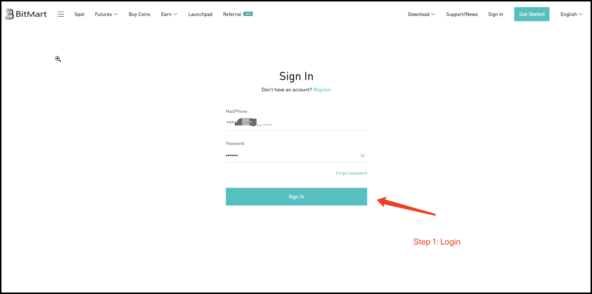
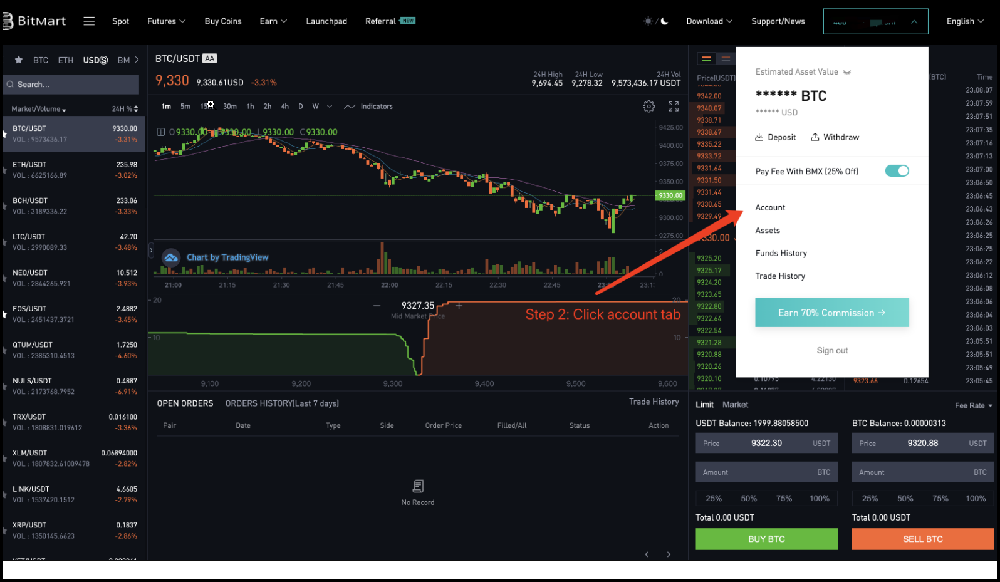
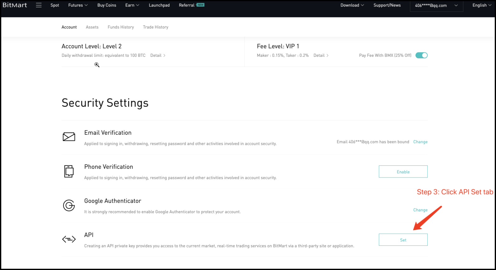
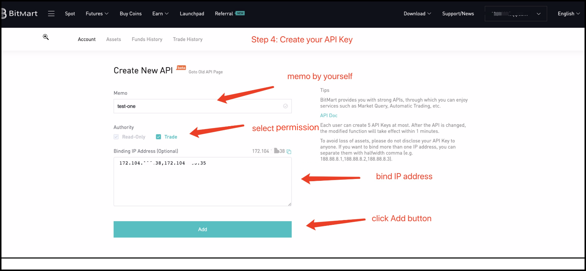
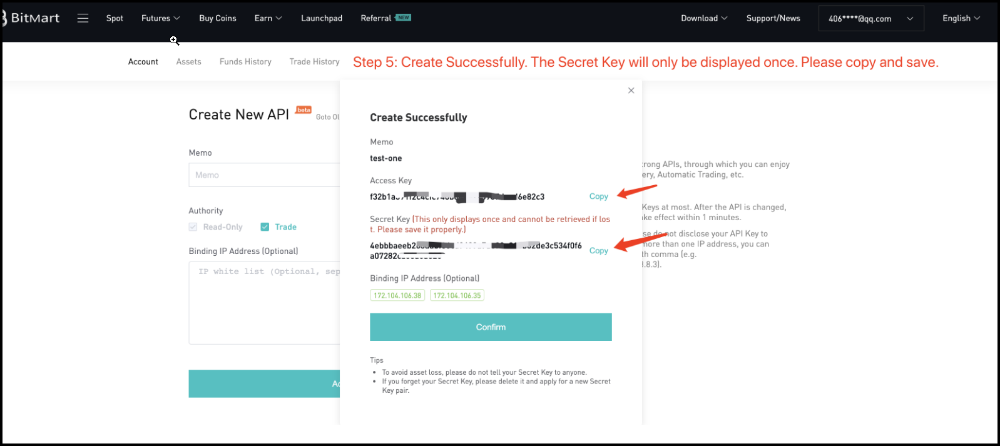

!!! warning "BitMart has ceased trading"
    BitMart announced the [orderly cessation of its operations](https://bitmart.zendesk.com/hc/en-us/articles/53544595916059-Important-Notice-Regarding-the-Orderly-Cessation-of-BitMart-Operations) on July 26, 2026. New registrations, deposits, new orders and API trading were phased out from that date, and **all spot, futures and other trading services stopped on August 26, 2026 at 01:00 UTC**. BitMart plans to end platform operations on January 31, 2027 at 15:59 UTC; withdrawals go through BitMart's own process.

    BitMart's later [restructuring proposal](https://bitmart.zendesk.com/hc/en-us/articles/56571281537051-Announcement-on-BitMart-s-Initial-Indicative-Proposal-and-Roadmap) makes any restart of the business conditional on funding. It is not a confirmation that trading will resume.

    Do not create a BitMart account or deposit funds to run Hummingbot. The `bitmart` and `bitmart_perpetual` connectors cannot trade while the exchange is closed, and the instructions below are kept for historical reference only.

## 🛠 Connector Info

- **Exchange Type**: Centralized Exchange (**CEX**)
- **Market Type**: Central Limit Order Book (**CLOB**)

| Component | Status | Connector Version | V2 Strategies | Notes | 
| --------- | ------ | ----------------- |  ------------ | ----- |
| [🔀 Spot Connector](#spot-connector) | ⛔ | v2.1 | Yes | Exchange ceased trading Aug 26, 2026 |
| [🔀 Perp Connector](#perp-connector) | ⛔ | v2.1 | Yes | Exchange ceased trading Aug 26, 2026 |
| 🕯 Spot Candles Feed | Not built  | 
| 🕯 Perp Candles Feed | Not built  | 

## ℹ️ Exchange Info

- **Website**: <https://www.bitmart.com/>
- **CoinMarketCap**: <https://coinmarketcap.com/exchanges/bitmart/>
- **CoinGecko**: <https://www.coingecko.com/en/exchanges/bitmart>
- **API Docs**: <https://www.bitmart.com/api-docs>
- **Fees**: <https://www.bitmart.com/fee/en>

## 🔑 How to Connect

!!! note "Historical"
    These steps describe how to connect while BitMart was operating. They no longer work now that trading has stopped.

### Generate API Keys

- Login

    

- Click Account tab

    

- Click Settings in the API tab

    

- Create your API KEY

    

- Create Successfully. The Secret Key will only be displayed once. Please copy and save.

    

- Click Confirm button to exit. Now you can use your new API.

### Add Keys to Hummingbot

From inside the Hummingbot client, run `connect bitmart`:

```
Enter your bitmart API key >>>
Enter your bitmart secret key >>>
```

If connection is successful:

```
You are now connected to bitmart
```


## 🔀 Spot Connector
*Integration to spot markets API endpoints*

- **ID**: `bitmart`
- **Connection Type**: WebSocket
- **Folder**: <https://github.com/hummingbot/hummingbot/tree/master/hummingbot/connector/exchange/bitmart>

### Order Types

This connector supports the following `OrderType` constants:

- `LIMIT`
- `LIMIT_MAKER`

### Paper Trading

Access the [Paper Trade](../../client/global-configs/paper-trade.md) version of this connector by running `connect bitmart_paper_trade` instead of `connect bitmart`.

If this is not available by default, you can configure Hummingbot to add this paper trade exchange. See [Adding Exchanges](../../client/global-configs/paper-trade.md#adding-exchanges) for more information.

## 🔀 Perp Connector
*Integration to perpetual futures markets API endpoints*

- **ID**: `bitmart_perpetual`
- **Connection Type**: WebSocket
- **Folder**: <https://github.com/hummingbot/hummingbot/tree/master/hummingbot/connector/derivative/bitmart_perpetual>

### Order Types

This connector supports the following `OrderType` constants:

- `LIMIT`
- `MARKET`

### Position Modes

This connector supports the following position modes:

- One-way
- Hedge

### Paper Trading

Access the [Paper Trade](../../client/global-configs/paper-trade.md) version of this connector by running `connect bitmart_paper_trade` instead of `connect bitmart_perpetual`.

If this is not available by default, you can configure Hummingbot to add this paper trade exchange. See [Adding Exchanges](../../client/global-configs/paper-trade.md#adding-exchanges) for more information.
